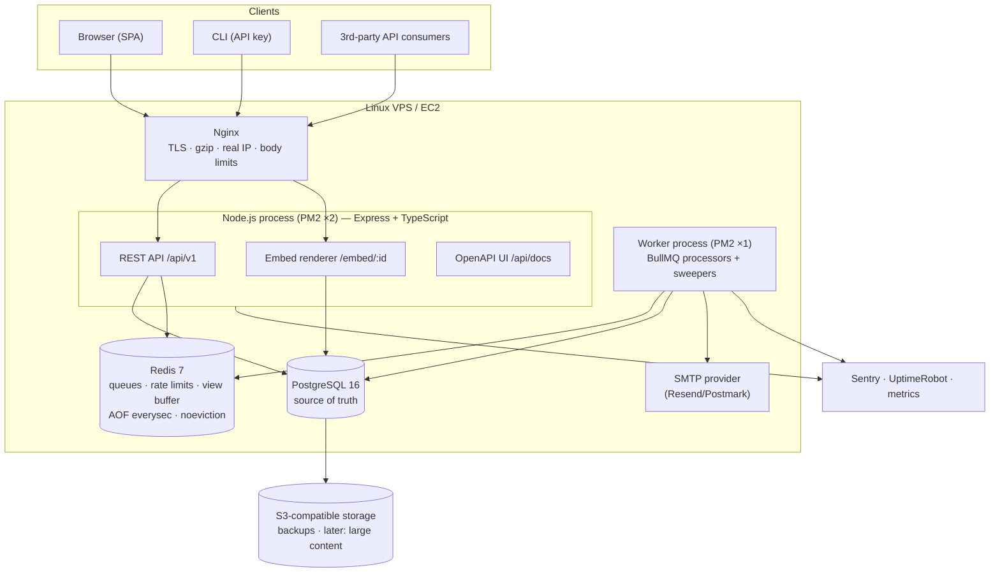
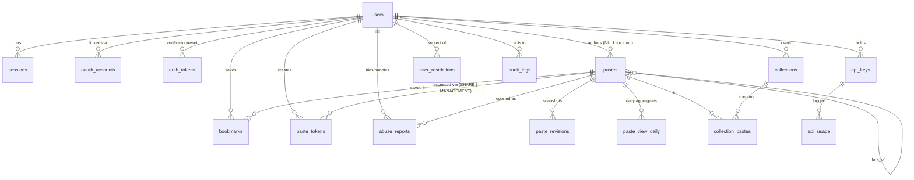
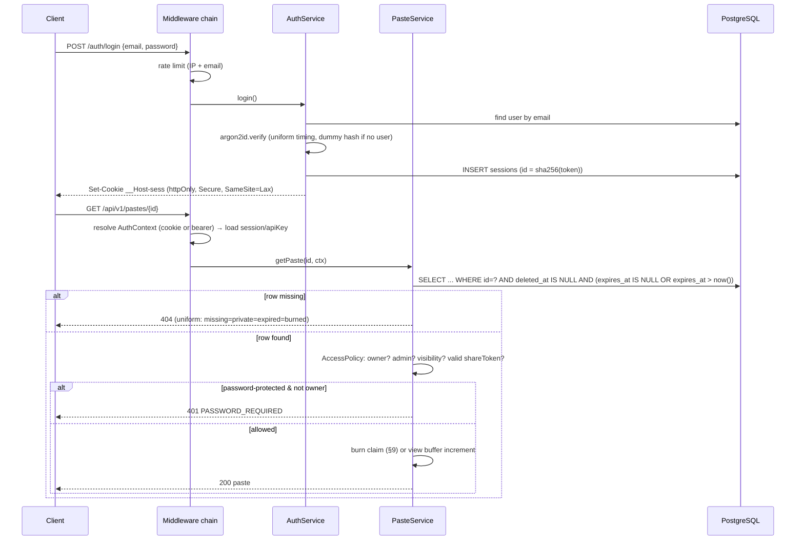
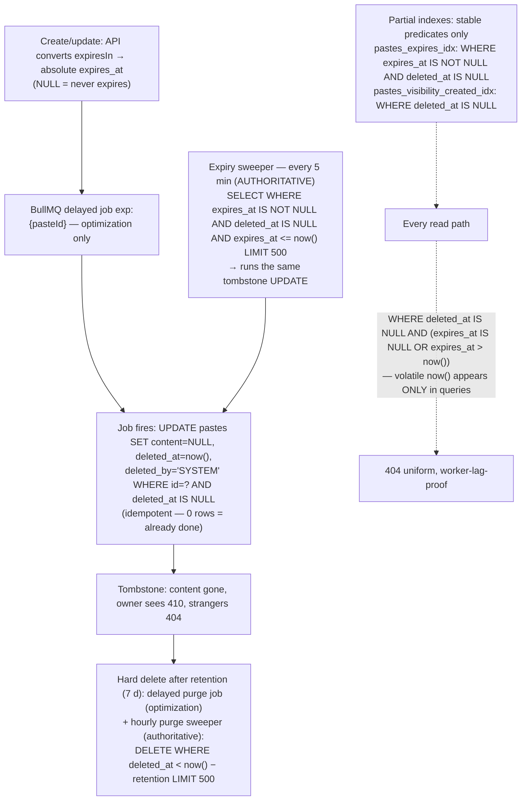
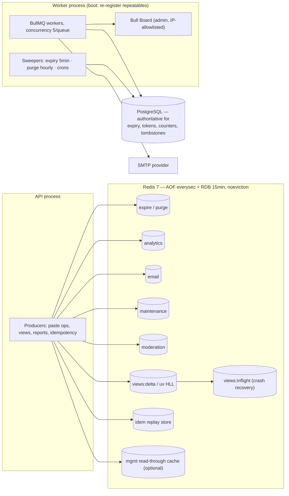
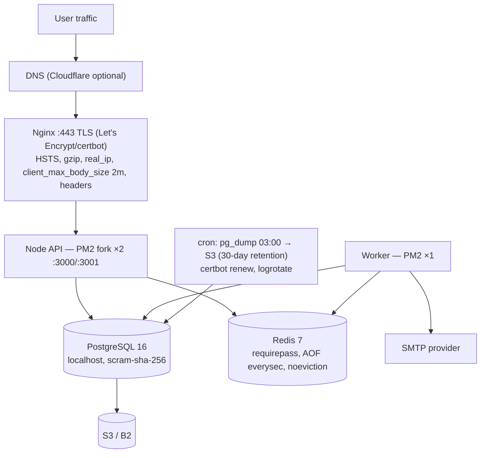

# Pastebin Platform — Backend Architecture Blueprint

**Status:** Revision 2 — approved (with 8 corrections incorporated). Authoritative design record for implementation.
**Scope:** Complete backend architecture: database, API, security, Redis/jobs, testing, deployment, roadmap.
**Implementation note:** The full schema below is the design record; Prisma migrations ship **per phase** — each phase implements only the tables it needs (see §19).

---

## 1. Executive Architecture Overview

A single deployable **modular monolith** (Express + TypeScript) with a separate **worker process** sharing the same codebase. All state lives in **PostgreSQL** (source of truth) and **Redis** (ephemeral: rate limits, view buffers, queues). Nginx terminates TLS and fronts both processes.

Core architectural principles:

1. **Authorization is enforced in the service layer.** Middleware only *resolves* an auth context (session cookie, API key, anonymous token); every paste/collection/user operation calls a central policy service that decides based on visibility + identity. Nothing relies on ID secrecy.
2. **The database is the expiry/burn authority.** Every read path filters on `expires_at > now()` (volatile functions appear **only** in queries — never in index predicates) and `deleted_at IS NULL` inside the SQL `WHERE` clause. `expires_at IS NULL` normatively means "never expires". Expired content is inaccessible even if the background worker is delayed; BullMQ jobs merely perform cleanup.
3. **Hot-path writes are buffered in Redis, flushed in batches.** View counters increment in Redis (fire-and-forget); a flush job applies them exactly-once with crash recovery. Correctness-sensitive counters (`max_views`, burn-after-read) take synchronous guarded SQL updates instead.
4. **All secrets are stored hashed; raw values are shown once.** All user content is untrusted data — never executed, always escaped/sanitized on render.
5. **Start small, scale incrementally.** One VPS, content ≤ 1 MB stays in PostgreSQL, cursor pagination, no premature sharding/object storage.

**Ambiguities resolved with explicit defaults:**

| Ambiguity | Resolution |
|---|---|
| Max paste size | 1 MB (all users); per-day creation quotas differ for anon vs. registered |
| Expired/burned paste response | Uniform **404** for strangers (anti-enumeration); **410 Gone** visible only to the owner |
| Email verification gating | Required before **API key creation**; soft (nag email) otherwise |
| Revisions on metadata-only edits | No revision — content changes only; title/desc/language snapshotted alongside content revisions |
| Burn-after-read trigger | First successful *content delivery* (raw, main view, download, API); atomic consumption — concurrent requests can never both succeed |
| Anonymous management | One-time 32-byte management token; SHA-256 hash stored in PostgreSQL (`paste_tokens`), Redis = optional read-through cache |
| OAuth account linking | Auto-link only via **provider-verified** email; else error |
| Usernames | Immutable |
| `max_views` semantics | Enforced synchronously (exact); normal pastes tolerate ≤ one flush-window analytics over-run |

---

## 2. Architecture Diagram



---

## 3. Technology Stack Justification

| Layer | Choice | Justification | Notes / trade-offs |
|---|---|---|---|
| Runtime | Node.js 22+ LTS | One language across API+workers; huge ecosystem | — |
| Language | TypeScript (strict mode) | Compile-time contracts | `strict: true`, `noUncheckedIndexedAccess` |
| Framework | **Express 5** | Spec'd; v5 auto-forwards async errors | Express 4 rejected: manual async plumbing |
| DB | PostgreSQL 16 | Relational core, FTS, partial indexes, strong consistency | — |
| ORM | Prisma | Type-safe queries, migrations, schema-as-code | Gaps: partial indexes & `tsvector` need raw SQL migrations (§5.3) |
| Cache/queues | Redis 7 + BullMQ | Rate limiting, view buffering, delayed jobs in one dependency | AOF everysec + noeviction; holds only reconstructable state |
| Validation | Zod | Runtime validation + OpenAPI generation from the same schemas | `@asteasolutions/zod-to-openapi` |
| Auth | Custom sessions (Argon2id, httpOnly cookies) + OAuth (Google/GitHub, state+PKCE) | Full control; session = DB row + hashed token cookie | Sessions in **PostgreSQL**, not Redis |
| Logging | Pino | Fast structured logger; request-id child loggers | — |
| Docs | OpenAPI 3.1 + Swagger UI | Generated from Zod, always in sync | — |
| Testing | Vitest | Native TS, fast, good mocking | Real PG+Redis via docker-compose |
| Process mgmt | PM2 | Cluster mode + reload deploys | Docker Compose is the alternative |
| Email | Nodemailer → SMTP provider | Deliverability handled by provider | MailHog in dev |
| Rate limiting | `rate-limit-redis` + Lua sliding window | Atomic across app instances | — |
| Crypto | `node:crypto` + `argon2` | No extra deps | `timingSafeEqual` for all token compares |

Deliberately **not** added: GraphQL, microservices, Kafka, Elasticsearch, auth libraries, WYSIWYG renderers, dependency-hungry frameworks.

---

## 4. Module-by-Module Architecture

### A. Paste Management
- `POST /pastes` runs in one transaction: insert `pastes` row + `paste_revisions` row (revision 1 = initial snapshot) + `paste_tokens` row (anonymous management token hash, when anonymous). `content_hash` (SHA-256) stored for dedupe signals and skip-if-unchanged updates.
- ID: 10 chars from an unambiguous 56-char alphabet (`crypto.randomBytes`, excludes `0 O 1 l I`), PK on `pastes.id`, collision retry ≤ 3. Custom slug: optional, 3–64 chars `[a-z0-9-_]`, **globally unique**, checked against reserved-word list.
- Raw/download are read-only variants with different content negotiation (`text/plain`, `Content-Disposition`).
- `view_count` is a denormalized counter maintained by the Redis flush job (§12). Forks copy content into a new paste with `fork_of_id`.
- Size limit enforced twice: Nginx `client_max_body_size 2m` and Zod-level `1 MB` on content bytes.

### B. Visibility & Authorization
Central `AccessPolicy` service — single function every read path calls:

```
authorizePasteView(paste, ctx) → ALLOW | PASSWORD_REQUIRED | NOT_FOUND
```

| Viewer | Public | Unlisted | Private | Password-protected |
|---|---|---|---|---|
| Anonymous (no token) | ✅ | ✅ (link) | ❌ 404 | ✅ after unlock |
| Owner | ✅ | ✅ | ✅ | ✅ (bypasses password) |
| Admin | ✅ | ✅ | ✅ | ✅ (bypass) |
| Share token (private) | — | — | ✅ | — |
| API key / management token | acts as its owner | acts as its owner | acts as its owner | acts as its owner |

- **Unlisted is excluded by construction:** every listing/search/feed query filters `visibility = 'PUBLIC'` (plus `deleted_at IS NULL`, `expires_at > now()`).
- Obscurity never authorizes: private = owner/admin/share-token only; anonymous management = explicit token presented per request, verified against the **PostgreSQL-stored hash** (`paste_tokens`, `purpose = MANAGEMENT`); Redis `mgmt:{pasteId}` is an optional 15-min read-through cache, never authoritative.
- Share tokens: hashed in DB, optional expiry/max-uses, grant read-only on private pastes.
- Burn-after-read: atomic consumption (§9) — a single guarded `UPDATE … RETURNING` is lock + claim + transition; concurrent consumers can never both succeed.

### C. Expiration Management
- `expires_at` is the single source of truth; API `expiresIn` durations are converted to **absolute timestamps** at creation; `NULL` = never expires.
- **Every read query includes `(expires_at IS NULL OR expires_at > now())`** — worker lag can never leak content.
- On create/update, an idempotent BullMQ delayed job `expire:{pasteId}` is scheduled (deterministic `jobId` prevents duplicates).
- Expiry job: `UPDATE pastes SET content=NULL, deleted_at=now(), deleted_by='SYSTEM' WHERE id=? AND deleted_at IS NULL` (idempotent) → purge (hard delete) after 7-day tombstone retention.
- The 5-minute **sweeper is the reconciliation authority** — it scans PostgreSQL directly (`expires_at <= now() AND deleted_at IS NULL`) and enforces expiry even if Redis and all delayed jobs are lost.

### D. Authentication & Users
- Sessions: 32-byte token → cookie `__Host-sess` (httpOnly, Secure, SameSite=Lax); DB stores SHA-256(token) as PK. Rolling 30-day idle expiry.
- Passwords: Argon2id (OWASP params: m=19 MiB, t=2, p=1); policy 10–128 chars; dummy-hash timing equalization on login.
- Email verification & password reset: single `auth_tokens` table, hashed token, 24 h / 1 h TTL, single-use.
- **OAuth specification (normative):**
  - **State (CSRF):** 32-byte CSPRNG `state`; stored in a single-use, httpOnly, Secure, SameSite=Lax cookie `__Host-oauth` (10-min TTL); compared on callback with `timingSafeEqual`; mismatch/consumed/missing → 400, no code exchange.
  - **PKCE:** S256 challenge/verifier for **both** providers (provider config flag); verifier lives only in the OAuth cookie.
  - **Verified-email requirement:** provider's primary email must be verified (Google `email_verified=true`; GitHub primary `verified=true`); unverified → `400 OAUTH_EMAIL_UNVERIFIED` — no account created, no linking.
  - **Account-linking rules (ordered, all audited):** (1) existing session → link to current user (unique constraint guards duplicates); (2) local user with same email **and** provider-verified email → auto-link (`account.link` audit); (3) no local user → create account (`email_verified=true`, `password_hash=NULL`) + fresh session.
  - Session fixation impossible: every OAuth login creates a new session row. No refresh tokens stored. Redirect URIs strict allowlist.

### E. Paste Revisions
- **Full snapshots, capped at 20 (drop-oldest).** Restore is a copy; compare computed on demand (`diff` lib → unified diff); no reconstruct bugs. `revision_no` monotonic; paste row mirrors latest. Only content-changing updates create revisions.
- Restore = copy revision snapshot into paste + create a *new* revision (append-only history).

### F. Collections & Bookmarks
- Collections have own visibility, owner-scoped slug, ordered `collection_pastes` with explicit `position` (renumbered in a transaction).
- Private paste in a public collection renders metadata-only for unauthorized viewers — collection responses reuse `authorizePasteView`.
- Bookmarks: composite PK `(user_id, paste_id)`, idempotent PUT, always private.

### G. Public Discovery
- All discovery queries filter `visibility='PUBLIC' AND deleted_at IS NULL AND expires_at > now() AND author.status='ACTIVE'` — private/unlisted **cannot** leak.
- Latest: `created_at DESC`. Popular: `view_count DESC`. Trending: views from `paste_view_daily` (last 48 h), recomputed every 5 min into a Redis cached zset.
- Search: PostgreSQL FTS (`tsvector` generated column over title+description, GIN index — raw SQL migration) + language + author filters. Full content search postponed.

### H. Developer API
- Same routes, second credential: `Authorization: Bearer pb_…` (37-char, 256-bit entropy). Stored as SHA-256 hash + display prefix. Show-once; revoke-only.
- API keys inherit owner's authorization, never admin. Blocked if owner suspended or email-unverified.
- Quotas: Redis counter per key per UTC day (24 h TTL), default 1,000 req/day. Usage rows via buffered batch inserts, 90-day retention.
- **Idempotency:** `POST /pastes` accepts optional `Idempotency-Key` header (8–128 chars, UUID recommended):
  - First request: Redis `SET NX` lock (`idem:{credential}:{key}`, 30 s TTL) → execute → cache `{status, body, requestHash}` 24 h (2xx only) → `Idempotency-Replayed: false`.
  - Retry, same key + same body → cached response replayed verbatim (`Idempotency-Replayed: true`), no duplicate resource.
  - Concurrent same key → `409 IDEMPOTENCY_IN_FLIGHT`. Same key, different body → `422 IDEMPOTENCY_KEY_REUSED` (body-hash comparison). 4xx/5xx never cached → safe retry with same key.
  - Redis-only storage (24 h TTL); catastrophic Redis loss degrades to "retry may duplicate" (accepted). Key abuse bounded: 128-char cap + per-credential rate limits + TTL.
- OpenAPI 3.1 generated from Zod; Swagger UI at `/api/docs`.

### I. Embedding
- Server-rendered `GET /embed/:id` (HTML): escaped content + server-side highlight.js, strict CSP `default-src 'none'; style-src 'unsafe-inline'` — user content can never execute.
- Config: `theme`, `lines`, `range=10-50`. **Public and unlisted embeddable; private only with share token; password-protected: not embeddable.**
- `frame-ancestors *` on embed route only; everywhere else `X-Frame-Options: DENY`.

### J. Abuse Prevention & Administration
- Layers: per-route Redis sliding-window rate limits → per-day anonymous creation quota per IP → IP ban table on anonymous write paths → user restrictions (`SUSPENSION`, `UPLOAD_BAN`) → CAPTCHA point (Turnstile, env-gated).
- Abuse reports: anon-allowed, IP-hashed, rate-limited; OPEN → REVIEWED → RESOLVED/DISMISSED with admin resolution actions — each writes an audit log in the same transaction.
- Spam heuristic: ≥ 3 OPEN reports auto-unlist pending review; duplicate `content_hash` clusters flagged.

### K. Analytics
- Write path fully buffered: view → Redis `INCR` + HLL `PFADD` — never blocks the response. Exact spec in §12.1 (exactly-once flush with crash recovery; ≤ 60 s analytics loss on catastrophic Redis failure; zero double-counting).
- `max_views` / burn paths bypass buffering — synchronous conditional updates, exact.
- User-level stats: join `paste_view_daily` × `pastes` on `author_id`. Storage: `users.storage_used` counter + nightly reconciliation.

---

## 5. Database Design

17 tables. All timestamps `TIMESTAMPTZ`. Internal PKs UUIDv7; `pastes.id` is the short public identifier itself.

### 5.1 Tables

**users**

| Column | Type | Null | Default | Notes |
|---|---|---|---|---|
| id | UUID | NO | uuidv7 | PK |
| email | VARCHAR(255) | NO | — | UNIQUE (lowercased at app layer) |
| email_verified | BOOLEAN | NO | false | |
| password_hash | TEXT | YES | — | NULL for OAuth-only accounts |
| username | VARCHAR(30) | NO | — | UNIQUE, immutable, reserved-word list |
| display_name | VARCHAR(80) | YES | — | |
| bio | VARCHAR(280) | YES | — | |
| avatar_url | TEXT | YES | — | |
| website_url | TEXT | YES | — | |
| role | user_role enum | NO | 'USER' | USER / ADMIN |
| status | user_status enum | NO | 'ACTIVE' | ACTIVE / SUSPENDED / DELETED |
| storage_used | BIGINT | NO | 0 | denormalized bytes, nightly reconcile |
| deleted_at | TIMESTAMPTZ | YES | — | soft delete / anonymization |
| created_at / updated_at | TIMESTAMPTZ | NO | now() | |

**sessions** — token hash is the PK (single indexed lookup per request):

| Column | Type | Null | Notes |
|---|---|---|---|
| id | VARCHAR(64) | NO | PK = SHA-256 hex of 32-byte token |
| user_id | UUID | NO | FK users CASCADE |
| ip | VARCHAR(45) | YES | |
| user_agent | VARCHAR(255) | YES | |
| expires_at | TIMESTAMPTZ | NO | rolling 30-day idle |
| created_at / last_used_at | TIMESTAMPTZ | NO | |

**oauth_accounts**

| Column | Type | Null | Notes |
|---|---|---|---|
| id | UUID | NO | PK |
| user_id | UUID | NO | FK users CASCADE |
| provider | oauth_provider enum | NO | GOOGLE / GITHUB |
| provider_account_id | VARCHAR(64) | NO | UNIQUE (provider, provider_account_id) |

**auth_tokens** (email verification + password reset, unified):

| Column | Type | Null | Notes |
|---|---|---|---|
| id | VARCHAR(64) | NO | PK = SHA-256 hex of token |
| user_id | UUID | NO | FK users CASCADE |
| type | auth_token_type enum | NO | EMAIL_VERIFICATION (24 h) / PASSWORD_RESET (1 h) |
| expires_at | TIMESTAMPTZ | NO | |
| used_at | TIMESTAMPTZ | YES | single-use |

**pastes** (core table):

| Column | Type | Null | Default | Notes |
|---|---|---|---|---|
| id | VARCHAR(12) | NO | — | PK; 10-char unambiguous ID (or custom slug) |
| author_id | UUID | YES | — | FK users CASCADE; NULL = anonymous |
| custom_slug | VARCHAR(64) | YES | — | UNIQUE **partial** (WHERE NOT NULL); global namespace |
| title | VARCHAR(140) | YES | — | |
| description | VARCHAR(500) | YES | — | |
| language | VARCHAR(50) | YES | — | user-declared, validated against highlight.js list |
| detected_language | VARCHAR(50) | YES | — | lightweight server heuristic |
| content | TEXT | **YES** | — | **Invariant: non-null iff `deleted_at IS NULL`** (tombstoning nulls it in same tx); ≤ 1 MB app-enforced |
| content_size | INTEGER | NO | — | original bytes, kept after tombstoning |
| content_hash | VARCHAR(64) | NO | — | SHA-256 |
| visibility | visibility enum | NO | 'PUBLIC' | PUBLIC / UNLISTED / PRIVATE |
| password_hash | TEXT | YES | — | Argon2id (lighter params than login) |
| max_views | INTEGER | YES | — | synchronous enforcement |
| view_count | BIGINT | NO | 0 | Redis-buffered flush; exact for max_views pastes |
| burn_after_read | BOOLEAN | NO | false | |
| burned_at | TIMESTAMPTZ | YES | — | |
| expires_at | TIMESTAMPTZ | YES | — | **NULL = never expires**; read-path filter + sweeper |
| deleted_at | TIMESTAMPTZ | YES | — | soft delete tombstone |
| deleted_by | deleted_by enum | YES | — | USER / MODERATOR / SYSTEM |
| fork_of_id | VARCHAR(12) | YES | — | FK pastes SET NULL |
| latest_revision_no | INTEGER | NO | 1 | |
| created_at / updated_at | TIMESTAMPTZ | NO | now() | |

Indexes (partial-index predicates are **stable expressions only** — never `now()`):
- `(visibility, created_at DESC)` **partial WHERE `deleted_at IS NULL`** — public feed
- `(visibility, language, created_at DESC)` — language-filtered feeds
- `(author_id, created_at DESC)` — profile / "my pastes"
- `(expires_at)` **partial WHERE `expires_at IS NOT NULL AND deleted_at IS NULL`** — sweeper
- `(deleted_at)` **partial WHERE `deleted_at IS NOT NULL`** — purge sweep
- `(content_hash)` — abuse clustering
- GIN on generated `search_vector` **partial WHERE `visibility = 'PUBLIC'`** (raw SQL, Phase 4)

**paste_revisions** (full snapshots): id UUID PK; paste_id FK CASCADE; revision_no INT; title/description/language snapshot; content TEXT NOT NULL; content_size; editor_id UUID NULL (FK SET NULL); created_at. UNIQUE (paste_id, revision_no). Cap 20.

**paste_view_daily** (aggregated; uniques from Redis HLL — no raw per-view table): composite PK (paste_id, day); views BIGINT; unique_visitors BIGINT. paste_id FK CASCADE.

**paste_tokens** (unified: anonymous management credentials + private-paste share tokens; **hash stored in PostgreSQL, authoritative**):

| Column | Type | Null | Notes |
|---|---|---|---|
| id | UUID | NO | PK |
| paste_id | VARCHAR(12) | NO | FK pastes CASCADE |
| token_hash | VARCHAR(64) | NO | UNIQUE; SHA-256 hex of 32-byte CSPRNG token; raw shown once |
| purpose | token_purpose enum | NO | MANAGEMENT / SHARE |
| created_by | UUID | YES | FK users SET NULL; NULL for anonymous management tokens |
| expires_at | TIMESTAMPTZ | YES | NULL = valid while paste exists (mirrors paste TTL when set) |
| max_uses | INT | YES | optional (share tokens) |
| use_count | INT | NO | 0 |
| revoked_at | TIMESTAMPTZ | YES | |
| created_at | TIMESTAMPTZ | NO | |

Index (paste_id, purpose).

**collections**: id UUID PK; owner_id FK CASCADE; slug VARCHAR(64) UNIQUE (owner_id, slug); title; description; visibility (default PRIVATE); created_at/updated_at.

**collection_pastes**: composite PK (collection_id, paste_id); both FK CASCADE; position INT; added_at. Index (paste_id).

**bookmarks**: composite PK (user_id, paste_id); both FK CASCADE; created_at. Index (paste_id).

**api_keys**: id UUID PK; user_id FK CASCADE; name VARCHAR(80); prefix VARCHAR(12); key_hash VARCHAR(64) UNIQUE; last_used_at; expires_at; revoked_at; created_at.

**api_usage**: id BIGINT identity PK; api_key_id FK **SET NULL** (usage survives key deletion); user_id FK CASCADE; endpoint; method; status_code; latency_ms; created_at. Indexes (api_key_id, created_at), (created_at). 90-day retention.

**abuse_reports**: id UUID PK; paste_id FK CASCADE; reporter_id FK SET NULL (anon allowed); reporter_ip_hash; reason enum (SPAM/MALWARE/HARASSMENT/COPYRIGHT/OTHER); details; status enum OPEN→REVIEWED→RESOLVED/DISMISSED; resolution_note; handled_by FK SET NULL; created_at/resolved_at. Index (status, created_at), (paste_id).

**audit_logs** (append-only): id BIGINT identity PK; actor_type enum (USER/ADMIN/SYSTEM/ANONYMOUS); actor_id FK SET NULL; actor_name snapshot; action VARCHAR(80); target_type/target_id; metadata JSONB; ip_hash; created_at. Indexes (actor_id, created_at), (target_type, target_id), (created_at).

**user_restrictions**: id UUID PK; user_id FK CASCADE; type enum (SUSPENSION/UPLOAD_BAN); reason; starts_at; ends_at NULL=permanent; lifted_at/lifted_by; created_by FK (admin); created_at.

**ip_bans** (separate table — lookup on anonymous write paths with no user row): id UUID PK; ip_hash UNIQUE; subnet_hash optional; reason; created_by FK (admin); expires_at; created_at.

### 5.2 Key design decisions

- **Soft vs. hard deletion:** user/moderator deletion and expiry set `deleted_at` + null `content` (tombstone). Purge job hard-deletes tombstones after retention (7 d expiry/burn/moderation, 30 d user-deleted) — cascades wipe revisions, views, tokens, reports.
- **Password-protected pastes:** `password_hash` on the paste row (Argon2id). Unlock failures rate-limited per IP+paste with exponential lockout. Owner/admin bypass.
- **Anonymous management tokens:** hash in `paste_tokens` (PostgreSQL-authoritative), created in the paste-insert transaction; Redis = optional read-through cache; raw token returned exactly once.
- **Cascading:** everything hangs off `pastes`/`users` with CASCADE; audit_logs and api_usage deliberately SET NULL to survive.
- **Retention:** sessions 30 d idle; auth_tokens purged when expired; api_usage 90 d; audit_logs 12 months; tombstones 7–30 d; HLL keys 7 d.

### 5.3 Raw SQL migrations (Prisma limitations) — stable predicates only

```sql
-- Phase 2: 001_partial_indexes.sql — all predicates stable; now() never appears here
CREATE UNIQUE INDEX pastes_custom_slug_uidx ON pastes (custom_slug)          WHERE custom_slug IS NOT NULL;
CREATE INDEX pastes_visibility_created_idx  ON pastes (visibility, created_at DESC) WHERE deleted_at IS NULL;
CREATE INDEX pastes_expires_idx             ON pastes (expires_at)     WHERE expires_at IS NOT NULL AND deleted_at IS NULL;
CREATE INDEX pastes_deleted_idx             ON pastes (deleted_at)     WHERE deleted_at IS NOT NULL;

-- Phase 4: 002_search_vector.sql
CREATE EXTENSION IF NOT EXISTS pg_trgm;
ALTER TABLE pastes ADD COLUMN search_vector tsvector GENERATED ALWAYS AS (
  to_tsvector('english', coalesce(title,'') || ' ' || coalesce(description,''))
) STORED;
CREATE INDEX pastes_search_gin_idx ON pastes USING GIN (search_vector) WHERE visibility = 'PUBLIC';
```

**Canonical read predicate (every paste read):**

```sql
WHERE id = $1
  AND deleted_at IS NULL
  AND (expires_at IS NULL OR expires_at > now())   -- NULL = never expires; now() is fine in queries
```

Sweeper: `WHERE expires_at IS NOT NULL AND deleted_at IS NULL AND expires_at <= now()` (index predicate stable, volatile comparison query-side).

### 5.4 Complete Prisma schema

See `prisma/schema.prisma` in-repo — it is kept in lock-step with this document. The full target model set (Phase 2: `Paste`, `PasteRevision`, `PasteViewDaily`, `PasteToken`; Phase 1: `User`, `Session`, `OAuthAccount`, `AuthToken`; Phase 5: `ApiKey`, `ApiUsage`; Phase 6: `Collection`, `CollectionPaste`, `Bookmark`; Phase 8: `AbuseReport`, `AuditLog`, `UserRestriction`, `IpBan`) with all enums (`UserRole`, `UserStatus`, `Visibility`, `AuthTokenType`, `OAuthProvider`, `AbuseReason`, `ReportStatus`, `ActorType`, `RestrictionType`, `DeletedBy`, `TokenPurpose`) is specified verbatim in the approved blueprint and added per-phase. Key contract points:

- `Paste.content` is **nullable** with the tombstone invariant (non-null iff `deleted_at IS NULL`).
- `PasteToken` unifies MANAGEMENT and SHARE tokens (`tokenHash` unique, `createdBy` nullable for anon).
- Raw-SQL indexes documented in schema comments: stable predicates only; expiry filtering exclusively in query WHERE clauses.

---

## 6. Entity Relationship Diagram



---

## 7. REST API Specification

### 7.1 Conventions

- **Base:** `/api/v1`. JSON (except `raw`, `download`, `embed`).
- **Auth context (middleware):** `Authorization: Bearer pb_…` → API key; else `__Host-sess` cookie → session; else anonymous. Services do authorization.
- **Success:** resources at top level; lists return `{ data: [...], pagination: { cursor?, hasMore } }`.
- **Errors:** `{ error: { code, message, details? }, requestId }`.

| Code | HTTP | Meaning |
|---|---|---|
| VALIDATION_ERROR | 400 | Zod failure |
| UNAUTHORIZED | 401 | Missing/invalid credentials |
| PASSWORD_REQUIRED | 401 | Paste is password-protected |
| INVALID_PASSWORD | 401 | Wrong password |
| FORBIDDEN | 403 | Not authorized |
| NOT_FOUND | 404 | Missing **or** private/expired/burned (uniform) |
| CONFLICT | 409 | Slug/username/email taken |
| IDEMPOTENCY_IN_FLIGHT | 409 | Same Idempotency-Key concurrently in flight |
| GONE | 410 | Owner viewing expired/burned paste |
| PAYLOAD_TOO_LARGE | 413 | Content > 1 MB |
| IDEMPOTENCY_KEY_REUSED | 422 | Same key, different body |
| QUOTA_EXCEEDED | 429 | Daily/creation quota hit |
| RATE_LIMITED | 429 | Rate limit hit (with `Retry-After`) |

- **Rate limit headers** everywhere: `RateLimit-Limit`, `RateLimit-Remaining`, `RateLimit-Reset`; 429 adds `Retry-After`.
- **Pagination:** keyset cursor `base64(createdAt|id)`, `limit` ≤ 50 (default 20).
- **Idempotency:** `Idempotency-Key` on `POST /pastes` (§4 H); response header `Idempotency-Replayed: true|false`.

### 7.2 Endpoint catalog

**Auth** (10 req/15 min/IP; login +5/hr per email): `POST /auth/register`, `POST /auth/login`, `POST /auth/logout`, `POST /auth/verify-email/request`, `POST /auth/verify-email/confirm`, `POST /auth/password-reset/request` (always 202), `POST /auth/password-reset/confirm`, `GET /auth/oauth/{provider}`, `GET /auth/oauth/{provider}/callback`.

**Users:** `GET /users/me`, `PATCH /users/me`, `DELETE /users/me` (password confirm), `GET /users/me/sessions`, `DELETE /users/me/sessions/{id}`, `DELETE /users/me/sessions` (all), `GET /users/me/analytics`, `GET /users/{username}` (public), `GET /users/{username}/pastes` (public only), `GET /users/{username}/collections` (public only).

**Pastes** (create anon 10/hr/IP + 20/day/IP; user 60/hr; read 300/min/IP; raw/download 120/min; unlock 10/15min/IP+paste; fork 20/hr):

| Method | Path | Auth | Purpose |
|---|---|---|---|
| POST | /pastes | anon / session / key | Create (`Idempotency-Key` supported) |
| GET | /pastes | public | Feed: `?sort=latest\|popular\|trending&language=&cursor=` |
| GET | /pastes/{id} | varies | Policy-gated (§4 B); `?share_token=` |
| PATCH | /pastes/{id} | owner / mgmt-token / admin | Update; content change → new revision |
| DELETE | /pastes/{id} | owner / mgmt-token / admin | Soft delete |
| GET | /pastes/{id}/raw | varies | text/plain |
| GET | /pastes/{id}/download | varies | attachment |
| POST | /pastes/{id}/unlock | anon+ | `{password}` → paste payload |
| POST | /pastes/{id}/fork | anon / session / key | Copy → new paste |
| GET | /pastes/{id}/stats | owner / admin | Views, daily series, uniques |
| POST | /pastes/{id}/share-tokens | owner | Create share token (private pastes) |
| DELETE | /pastes/{id}/share-tokens/{tokenId} | owner | Revoke |

**Revisions** (120/min): `GET /pastes/{id}/revisions`, `GET /pastes/{id}/revisions/{no}`, `GET /pastes/{id}/revisions/{no}/diff?to={no2}`, `POST /pastes/{id}/revisions/{no}/restore` (owner/mgmt-token).

**Collections** (60/min): `POST /collections`, `GET /collections` (mine), `GET /collections/{id}`, `PATCH`, `DELETE`, `POST /collections/{id}/pastes`, `DELETE /collections/{id}/pastes/{pasteId}`, `PATCH /collections/{id}/pastes` (reorder).

**Bookmarks** (120/min): `PUT /pastes/{id}/bookmark`, `DELETE /pastes/{id}/bookmark`, `GET /users/me/bookmarks`.

**Search & meta** (60/min/IP): `GET /search?q=&language=&user=&cursor=` (public only), `GET /languages`.

**API keys** (10/hr): `GET /api-keys`, `POST /api-keys` (full key shown once), `DELETE /api-keys/{id}`.

**Analytics:** `GET /users/me/api-usage`, `GET /pastes/{id}/stats`.

**Abuse** (10/hr/IP): `POST /reports` (anon allowed).

**Admin** (role=ADMIN, 120/min, audited): `GET /admin/stats`, `GET /admin/pastes`, `POST /admin/pastes/{id}/purge`, `GET /admin/users`, `POST /admin/users/{id}/suspend`, `POST /admin/users/{id}/unsuspend`, `GET /admin/reports`, `POST /admin/reports/{id}/resolve`, `GET /admin/audit-logs`, `GET/POST/DELETE /admin/ip-bans`.

**Health (unversioned):** `GET /healthz`, `GET /readyz`, `GET /metrics` (internal, Nginx-blocked).

**Embed (non-API):** `GET /embed/{id}?theme=dark&lines=on&range=10-50&share_token=`.

### 7.3 Representative examples

**Create paste (anonymous)** — `POST /api/v1/pastes`:
```json
// Request
{ "title": "Fix nested promises", "content": "const x = 1;\n...", "language": "typescript",
  "visibility": "unlisted", "expiresIn": "1d" }
// 201 Created
{ "id": "k7Rm2vXq9p", "url": "/p/k7Rm2vXq9p", "visibility": "unlisted",
  "expiresAt": "2026-11-05T18:40:12Z", "detectedLanguage": "typescript",
  "managementToken": "9f2Kx8-...43chars",
  "createdAt": "2026-11-04T18:40:12Z" }
```

**Retrieve with password** — `POST /api/v1/pastes/k7Rm2vXq9p/unlock`:
```json
// Request { "password": "hunter2!" }
// 200 → full paste object incl. content
// 401 { "error": { "code": "INVALID_PASSWORD", "message": "Incorrect password" } }
```

**List public pastes** — `GET /api/v1/pastes?sort=latest&limit=2`:
```json
{ "data": [ { "id": "aB3xY9", "title": "...", "language": "python",
      "author": { "username": "dev01", "displayName": "Dev" },
      "viewCount": 1204, "createdAt": "..." } ],
  "pagination": { "cursor": "MTczMDc...", "hasMore": true } }
```

**Error:**
```json
{ "error": { "code": "VALIDATION_ERROR", "message": "Invalid request",
    "details": [{ "path": "content", "message": "exceeds 1MB" }] },
  "requestId": "f47ac10b-58cc-4372-a567-0e02b2c3d479" }
```

---

## 8. Authentication & Authorization Flow



Password-reset and login use identical responses for unknown emails; login verifies against a dummy Argon2 hash when the user doesn't exist; OAuth callback validates `state` before anything else.

---

## 9. Paste Creation & Retrieval Flow

```mermaid
sequenceDiagram
    autonumber
    participant C as Client
    participant API as Express API
    participant DB as PostgreSQL (authoritative)
    participant RD as Redis (cache/buffer only)
    participant W as Workers

    C->>API: POST /pastes (content, visibility, opts, Idempotency-Key?)
    API->>API: rate limit → IP/quota checks → Zod validate
    alt Idempotency-Key present
        API->>RD: cached 2xx response? → replay (Idempotency-Replayed: true)
        API->>RD: else SET NX lock (30s) → 409 if concurrent duplicate
    end
    API->>DB: BEGIN: INSERT pastes + revision 1 + INSERT paste_tokens(MANAGEMENT, hash) + COMMIT
    API->>RD: SETEX mgmt:{id} (read-through cache, 15 min, optional)
    alt expiresAt set
        API->>RD: expire.add(jobId=exp:{id}, delay=expiresAt−now)
    end
    API-->>C: 201 + managementToken (raw shown exactly once)

    C->>API: GET /pastes/{id}
    API->>DB: SELECT ... WHERE id=? AND deleted_at IS NULL AND (expires_at IS NULL OR expires_at > now())
    alt no row
        API-->>C: 404 uniform (missing = private = expired = burned)
    else row found
        API->>API: AccessPolicy: owner/admin/visibility/share-token/password
        alt unauthorized
            API-->>C: 401 PASSWORD_REQUIRED / 404
        else burn_after_read (authorized)
            API->>DB: tx: conditional UPDATE SET burned_at, deleted_at WHERE burned_at IS NULL ... RETURNING content
            Note over DB,W: row lock serializes consumers; exactly one caller gets content; losers get 0 rows → 404
            API->>DB: same tx: UPDATE SET content = NULL
            API-->>C: 200 content (the single consumer)
        else normal (authorized)
            API->>RD: INCR views:delta:{id} + PFADD uv:{id}:{date} (fire-and-forget)
            API-->>C: 200 content
        end
    end
    Note over W: flush 60s: RENAME delta→inflight → apply → DEL (exactly-once)<br/>expiry job: tombstone; purge sweeper (authoritative): hard delete after retention
```

### Burn-after-read atomic consumption (normative)

```sql
-- Single transaction, READ COMMITTED. Authorization MUST be resolved BEFORE this
-- statement — unauthorized requests never consume.
UPDATE pastes
   SET burned_at = now(), deleted_at = now(), deleted_by = 'SYSTEM'
 WHERE id = $1
   AND burn_after_read
   AND burned_at IS NULL          -- claim guard: exactly one concurrent UPDATE matches
   AND deleted_at IS NULL
   AND (expires_at IS NULL OR expires_at > now())
RETURNING content, title, description, language, content_size;

-- Same transaction, immediately after a successful claim:
UPDATE pastes SET content = NULL WHERE id = $1;
COMMIT;
```

Semantics: the `UPDATE` takes a row-exclusive lock → concurrent consumers serialize; the `burned_at IS NULL` guard ensures **exactly one** caller receives content via `RETURNING`; every loser gets 0 rows → uniform 404. Content is nulled inside the same transaction, so a crash can never leave a consumed-but-readable paste. No `SELECT … FOR UPDATE` needed — single-row single-statement access is deadlock-free. Non-burn reads take no locks.

---

## 10. Paste Expiration Flow



Correctness stack: (1) query-side expiry filter is the access gate; (2) deterministic `jobId` prevents duplicate scheduling; (3) state-guarded idempotent tombstone UPDATE; (4) sweeper enforces expiry from PostgreSQL alone — even after total Redis loss.

---

## 11. Revision Management Flow

```mermaid
sequenceDiagram
    participant O as Owner
    participant PS as PasteService
    participant DB as PostgreSQL (tx)

    O->>PS: PATCH /pastes/{id} {content: newContent, ...}
    PS->>PS: authorize (owner/mgmt token) + validate size
    PS->>DB: BEGIN
    PS->>DB: sha256(newContent) == content_hash? → skip revision
    PS->>DB: rev_no = latest_revision_no + 1; INSERT paste_revisions (snapshot)
    PS->>DB: if rev_no > 20: DELETE oldest revision
    PS->>DB: UPDATE pastes (content, metadata, latest_revision_no, content_hash)
    PS->>DB: COMMIT
    PS-->>O: 200 {paste, revision: rev_no}

    O->>PS: POST /pastes/{id}/revisions/{n}/restore
    PS->>DB: read revision n (authorize first) → append as new revision + update paste
    Note over PS: restore never rewrites history — it creates revision (latest+1) with old content

    O->>PS: GET /pastes/{id}/revisions/3/diff?to=7
    PS-->>O: computed unified diff (on demand, not stored)
```

---

## 12. Redis & BullMQ Architecture

### 12.1 Redis usage

| Key pattern | Type | TTL | Purpose |
|---|---|---|---|
| `rl:{bucket}:{identity}` | hash/counter | window | Sliding-window rate limits (Lua, atomic) |
| `views:delta:{id}` | counter | until flush | Buffered view increments |
| `views:inflight:{id}:{runId}` | counter | crash window | Flush claim keys (recovery pass) |
| `uv:{id}:{YYYYMMDD}` | HLL | 7 d | Approximate unique visitors |
| `quota:anon:{ip}:{date}` | counter | 24 h | Anonymous daily creation quota |
| `apiq:{keyId}:{date}` | counter | 24 h | API daily quota (self-expiring) |
| `mgmt:{pasteId}` | string | 15 min | Optional read-through cache of management-token hash (DB authoritative) |
| `idem:{credential}:{key}` | JSON | 24 h | Idempotency replay store |
| `unlockfail:{ip}:{id}` | counter | 15 min | Unlock brute-force lockout |
| `cache:feed:{sort}` | JSON | 30–60 s | Discovery feed cache |
| `cache:paste:{id}` | JSON | 60 s | Hot public paste cache (public only, invalidated on mutation) |
| `trending:ids` | zset | 5 min | Recomputed trending list |
| BullMQ queues | streams | — | §12.2 |

**Not in Redis:** sessions, paste content, any durable business data. Redis is fully reconstructable.

### 12.2 View counting — normative spec

| Step | Mechanism | Guarantee |
|---|---|---|
| **Buffer** (post-response, normal pastes only) | Redis pipeline: `INCR views:delta:{id}` + `PFADD uv:{id}:{yyyyMMdd} h(visitorHash)`; `visitorHash = HMAC-SHA256(secret, ip+ua)` truncated 16 B | Never blocks the response |
| **Flush** (BullMQ repeatable, 60 s) | ① Recovery pass: `SCAN views:inflight:*` — process keys left by crashed runs, then `DEL`. ② For each `views:delta:*`: atomic `RENAME delta → inflight:{runId}` (concurrent flush cannot double-claim; losers get ENOENT) → read → apply → `DEL inflight` | In-flight deltas survive worker crash; exactly-once during normal operation |
| **Apply** | One tx per paste: `UPDATE pastes SET view_count = view_count + $d` + `INSERT paste_view_daily … ON CONFLICT (paste_id, day) DO UPDATE SET views = paste_view_daily.views + $d`. Paste purged → discard delta, log | Consistent snapshot of counter + daily row |
| **Unique visitors** | Hourly: `PFCOUNT uv:{id}:{date}` → upsert `unique_visitors = GREATEST(existing, count)` (monotonic) → `DEL` key; keys expire 7 d | HLL approximation (±0.8% std. error) |
| **Exact counters** | `max_views` and burn paths bypass buffering — synchronous conditional UPDATE | Exact, no over-run |
| **Crash / Redis loss** | Worker crash → inflight keys recovered next flush. Full Redis loss → at most one flush window (60 s) of deltas lost | **Accepted analytics loss: ≤ 60 s on catastrophic Redis failure; zero double-counting** |
| **Reconciliation** | Nightly: compare `view_count` vs `SUM(paste_view_daily.views)`; divergence > 5% → alert only | Drift visible, never silently "fixed" |

### 12.3 Queues — persistence, reconstruction, retries

**Redis persistence:** `appendonly yes` + `appendfsync everysec` + RDB snapshot 15 min; `maxmemory-policy noeviction`; `maxmemory` ≤ 40% host RAM; BullMQ connection `maxRetriesPerRequest: null`.

**Job reconstruction after Redis loss:** queue state is never correctness-bearing — `expire`/`purge` enforced by sweepers from PostgreSQL; repeatable jobs re-registered idempotently at **worker boot** (`upsertJobRepeatable` with fixed repeat keys); view deltas gone → accepted 60 s loss.

| Queue | Producer | Job | Attempts | Backoff | Stalled |
|---|---|---|---|---|---|
| `expire` | paste create/update | tombstone (idempotent) | 5 | exp 2 s·2ⁿ | 30 s / max 2 |
| `purge` | expire / sweeper | hard DELETE past retention | 5 | exp 2 s | 30 s / 2 |
| `analytics` | repeatable 60 s | flush deltas + HLL | 5 | exp 5 s | 30 s / 2 |
| `email` | auth/abuse services | verification, reset, digests | 5 | exp 30 s | 30 s / 2 |
| `maintenance` | repeatable crons | sweeps, retention, reconcile | 3 | exp 60 s | 60 s / 2 |
| `moderation` | report create | spam heuristics | 3 | exp 30 s | 30 s / 2 |

`removeOnComplete: { age: 86400, count: 1000 }`; failures retained (dead-letter view via Bull Board, admin-only) + Prometheus gauge + Sentry alert. All processors idempotent (state-guarded SQL) → at-least-once delivery is safe.

**Deliberately synchronous (no job):** paste create/update/delete, session ops, unlock, burn consumption, `max_views` enforcement, API-key CRUD.

**Reconciliation mechanisms (complete list):** expiry sweeper (5 min) · purge sweeper (hourly) · flush inflight recovery (every flush) · repeatable-job boot re-registration · nightly `view_count` reconcile (alert-only) · nightly `storage_used` recompute (corrective) · hourly session/auth-token sweep · daily `api_usage` retention · failed-job gauge alerting.



---

## 13. Security Threat Model

| Threat | Mitigation |
|---|---|
| SQL injection | Prisma parameterizes everything; `$queryRaw` banned except migration files |
| XSS | User content rendered as text via escaped server-side highlighting; Markdown only via `sanitize-html` allowlist; embed pages under strict CSP `default-src 'none'`; API serves JSON |
| Malicious embedded content | Server-rendered HTML with CSP sandbox, no inline handlers, no user HTML pass-through; never executed server-side |
| CSRF | `SameSite=Lax` + **Origin header validation** on non-GET cookie-authenticated requests + `__Host-` prefix. Bearer clients CSRF-immune |
| SSRF | No server-side outbound fetch depends on user input (language detection is content-local) |
| IDOR / broken access control | Single `AccessPolicy` service on every route; CI-enforced authorization matrix suite |
| Session hijacking | 256-bit token, hashed at rest, `__Host-` + httpOnly + Secure + SameSite=Lax, HSTS, 30-day idle expiry, per-session IP/UA display, logout-all |
| Password storage | Argon2id (m=19 MiB, t=2, p=1); 10–128 char policy; dummy-hash timing equalization |
| API key leakage | 256-bit keys, SHA-256 at rest, show-once, prefix-only display, revoke-only, per-key daily quota, `last_used_at` visible |
| Anonymous deletion-token theft | Hash in PostgreSQL (authoritative); raw shown once over TLS; required per mutating request; revocation = paste deletion; Redis cache non-authoritative |
| Token theft in URLs (share tokens) | `Referrer-Policy: strict-origin-when-cross-origin`; POST-body for programmatic use; revocable + optional expiry/max-uses |
| Brute force (login/unlock/reset) | Sliding-window limits: login 10/15 min/IP + 5/hr/email; unlock 10/15 min/IP+paste with exponential lockout; reset 5/hr/IP |
| Rate-limit bypass | Only Nginx sets `X-Forwarded-For` (`trust proxy` = 1 hop); direct ports firewalled; identity = user id > API key id > IP |
| Enumeration | Uniform 404 across missing/private/expired/burned; generic reset response; no "email exists" errors; timing equalization |
| Resource exhaustion | Nginx `client_max_body_size 2m`; body limit 1.1 MB; per-route limits; anon daily quotas; pagination caps; SQL `LIMIT` everywhere; 1 MB content cap; queue concurrency caps; DB statement timeout 10 s |
| Clickjacking | `X-Frame-Options: DENY` site-wide; embed route uses `frame-ancestors` CSP |
| Burn-after-read double consumption | Single guarded `UPDATE … RETURNING` (row lock + `burned_at IS NULL`); authorization precedes consumption; content nulled same tx; CI concurrency test |
| OAuth CSRF / code interception | Single-use `state` cookie + timing-safe compare; PKCE S256 both providers; strict redirect allowlist; 10-min TTL |
| OAuth account takeover via unverified email | Provider email must be verified before create/link; linking audited |
| Idempotency-key abuse | Key cap 128 chars; per-credential rate limits; 24 h TTL; body-hash → 422 |
| Volatile expressions in index predicates | Convention enforced in review: stable predicates only; `now()` only in queries; migrations lint-checked |
| Secrets on disk | `.env` chmod 600, Pino redaction of `password`/`token`/`authorization`; rotation runbook |
| Log injection | Pino JSON serialization escapes control chars; user content never logged at info |

**Global rules:** treat all user content as untrusted data; never execute submitted code server-side; never store a plaintext secret; deny by default at the service layer.

---

## 14. Project Folder Structure

```
paste-backend/
├── prisma/
│   ├── schema.prisma          # grows per phase; full design in docs/ARCHITECTURE.md
│   └── migrations/            # per-phase migrations incl. raw SQL
├── src/
│   ├── config/
│   │   ├── env.ts             # Zod-validated process.env (fail-fast at boot)
│   │   └── constants.ts       # rate limits, quotas, caps, reserved words
│   ├── app.ts                 # Express assembly: middleware + routers
│   ├── server.ts              # bootstrap + graceful shutdown (SIGTERM)
│   ├── worker.ts              # worker-process entrypoint
│   ├── routes/                # route tables only (thin)
│   ├── controllers/           # HTTP shape: validate → service → response
│   ├── services/              # ALL business logic; authorization enforced here
│   │   └── access-policy.ts   # central visibility/role decision service
│   ├── repositories/          # ALL Prisma access
│   ├── middleware/            # auth-context, require-auth, rate-limit,
│   │                          # validate, origin-guard, error-handler
│   ├── validators/            # Zod schemas (reused for OpenAPI)
│   ├── queues/                # BullMQ queue definitions + producers
│   ├── workers/               # processors: expire, purge, analytics, email,
│   │                          # maintenance, moderation
│   ├── lib/                   # prisma, redis, logger, tokens, crypto,
│   │                          # pagination, language-detect, captcha
│   ├── types/                 # AuthContext, domain types, error codes
│   └── plugins/               # helmet/CSP, openapi.ts
├── tests/
│   ├── unit/  ├── integration/  ├── api/  ├── workers/  └── load/
├── deploy/                    # nginx.conf, ecosystem.config.js, deploy.sh
├── docs/ARCHITECTURE.md
├── docker-compose.yml
├── .env.example
└── openapi.json               # generated at build (later phase)
```

**Responsibilities:** Routes = URL wiring. Controllers = HTTP adaptation (no logic). **Services = business rules + authorization (the security boundary).** Repositories = all SQL/Prisma. Middleware = cross-cutting. Validators = request shapes (reused for OpenAPI). Workers = independent idempotent processors. Flat structure — no `domain/`, `use-cases/`, or DI container.

---

## 15. Testing Strategy

| Layer | Tooling | What it covers |
|---|---|---|
| Unit | Vitest, mocked repos | AccessPolicy matrix, token utils, validators, language detect, quota math |
| Integration | Vitest + docker-compose (real PG+Redis) | Repositories, service logic in transactions, revision cap, flush math, HLL |
| API / E2E | supertest | Auth flows, cookie flags, CSRF, error envelope, pagination, OpenAPI sync |
| Security suite | CI-enforced | Authorization matrix (every route × viewer kind), IDOR probes, expired-before-worker, burned double-read, unlisted-not-in-feed, password bypass, cookie flags, 413 boundary |
| Rate limiting | Real Redis, time injection | Bucket identity behind proxy; limit→429→Recovery-After; unlock lockout |
| Expiration | Fake timers + worker | Create→expire→404 pre-worker; tombstone→purge; sweeper catches lost jobs; idempotent re-runs |
| Workers | BullMQ in-process | Retry on injected failure; idempotency (run twice = same state); flush crash recovery; DLQ retention |
| Load | k6 | 500 rps mixed read/write, p95 < 150 ms warm; spike test; rate limits at load |

**Added Rev 2 mandatory suites:** burn concurrency (N parallel reads → exactly one 200, others 404; unauthorized never consume) · flush recovery (kill mid-run → inflight keys applied once, no double-count) · idempotency (replay, concurrent 409, key-reuse 422, failures not cached) · OAuth (state mismatch/consumed, PKCE mismatch, unverified-email no-create/no-link, verified auto-link, provider-id uniqueness).

**Pre-production gate:** full authorization matrix; uniform-404 tests; expired/burned race tests; CSRF suite; rate-limit identity tests; migrations up/down on production-shaped dump; backup-restore drill.

---

## 16. Monitoring & Observability

| Concern | Tool | Role |
|---|---|---|
| Structured logs | Pino JSON → journald + logrotate | One line per request: requestId, route, status, latency, auth kind; worker child loggers with jobId |
| Request tracing | requestId (ULID) end-to-end incl. queue jobs | Single correlation id |
| Error tracking | Sentry (free tier) | Exceptions + release tagging + new-issue alerts |
| Health | `/healthz` (liveness), `/readyz` (PG+Redis ping, queue heartbeat) | PM2 restart + UptimeRobot |
| App metrics | prom-client `/metrics` (Nginx-blocked) | HTTP latency histogram, DB pool, queue depth/failed, flush lag, Redis memory |
| DB | pg_stat_statements + pgBadger weekly | Slow queries, index usage; alert connections > 80% |
| Redis | redis_exporter / INFO cron | Memory (noeviction), evictions (must be 0), hit ratio |
| Workers | Bull Board + queue gauges | Stalled/failed/backlog age; alert analytics backlog > 2 windows |
| Host | Netdata / node_exporter | CPU/RAM/disk (disk is the early killer) |

Alerts (start with 3): app down · 5xx > 1% for 5 min · disk > 80%.

---

## 17. Deployment Architecture



- **Environment variables** (Zod-validated, fail-fast): `DATABASE_URL`, `REDIS_URL`, `SESSION_SECRET`, `COOKIE_KEYS`, `PORT`, `NODE_ENV`, `TRUST_PROXY=1`, `FRONTEND_ORIGIN`, `SENTRY_DSN`, `SMTP_*`, `GOOGLE_CLIENT_ID/SECRET`, `GITHUB_CLIENT_ID/SECRET`, `CAPTCHA_*`, `S3_BACKUP_*`, limit overrides. Secrets: `.env` chmod 600 → SSM later; rotation runbook.
- **Migrations:** `prisma migrate deploy` under Postgres advisory lock; expand-then-contract policy; never destructive in the same release as dependent code.
- **Deploy:** CI (typecheck, lint, tests) → tag → `deploy.sh`: fetch tag → `npm ci` → build → migrate → `pm2 reload app` → `pm2 restart worker` → `/readyz` gate → auto-rollback on failure.
- **Graceful shutdown:** SIGTERM → stop accepting → drain in-flight → close BullMQ workers (bounded 30 s) → flush view deltas → disconnect Redis/PG. PM2 `kill_timeout: 10000`.
- **Backups:** nightly `pg_dump -Fc` + weekly full → S3 (versioned, 30-day), Redis AOF (≤ 1 s buffer loss acceptable), restore runbook tested quarterly. RPO 24 h / RTO ~1 h.
- **Cost:** single VPS ($20–40/mo) + free-tier S3/Sentry/UptimeRobot ≈ **under $50/mo**.

---

## 18. Scalability Bottlenecks & Growth Path

| # | Bottleneck | Trigger | Action |
|---|---|---|---|
| 1 | Read throughput | CPU > 70% sustained | More PM2 instances → 2nd VM (stateless design) |
| 2 | Flush write contention | hot-paste UPDATE contention | Longer flush windows; coalescing; `view_count` approximate by design |
| 3 | 1 MB TOAST + revision snapshots | DB > 50 GB or p95 > 200 ms | Move content to S3 (schema-ready: content nullable + s3_key) |
| 4 | Full-text search | GIN > 20% DB or slow | Trigram prefilter → Meilisearch/Typesense sidecar |
| 5 | Connection count | > 200 conns | PgBouncer (transaction pooling) |
| 6 | api_usage / audit growth | > 10 M rows | Monthly partitions |
| 7 | Worker throughput | backlog age > 1 min | More worker processes; per-queue concurrency |
| 8 | Single PG primary | write-bound / HA needed | Managed PG + read replica |
| 9 | Static/raw bandwidth | cost | CDN for public `/raw` (`s-maxage`); embeds stay dynamic |
| 10 | L7 attack volume | abuse | Cloudflare proxy + WAF |

**Cursor (keyset) pagination everywhere user-facing; offset only in admin dashboards.** Nothing above needed before ~100k pastes / ~50 rps sustained.

---

## 19. Phased Implementation Roadmap (per-phase migration slicing)

| Phase | Deliverables | Migrations shipped | Gate |
|---|---|---|---|
| **0 — Foundation** | Scaffold, strict TS, Zod env, docker-compose, Pino+requestId, error envelope, health endpoints, CI, PM2/Nginx scripts | Baseline only (empty) | CI green |
| **1 — Auth & users** | Register/login/logout, sessions, Argon2id, verify/reset, OAuth (state+PKCE+verified-email+linking), profiles, account deletion, session mgmt | `users`, `sessions`, `oauth_accounts`, `auth_tokens` | OAuth tests green |
| **2 — Paste core** | CRUD, visibility policy, password/unlock, expiration (filter+jobs+sweeper), atomic burn, max_views, anon management tokens (`paste_tokens`), raw/download, forks, view buffer+flush+recovery, anon quotas, partial-index migration | `pastes`, `paste_revisions`, `paste_tokens`, `paste_view_daily` + `001_partial_indexes.sql` | Burn concurrency + flush recovery + expiry-race tests green |
| **3 — Revisions** | Cap, history, diff, restore | none | revision suite green |
| **4 — Discovery** | Feeds latest/popular, keyset pagination, filters, title FTS, public profiles | `002_search_vector.sql` | leak tests green |
| **5 — Developer API** | API keys, bearer auth, quotas, usage capture, Idempotency-Key, OpenAPI+Swagger | `api_keys`, `api_usage` | idempotency + quota tests green |
| **6 — Collections & bookmarks** | CRUD, items, reorder, visibility | `collections`, `collection_pastes`, `bookmarks` | authz matrix extended |
| **7 — Analytics & embeds** | User analytics, HLL uniques, trending, storage accounting, embed renderer + CSP | none | HLL flush test green |
| **8 — Abuse & admin** | Reports, moderation, suspension, audit logs, admin endpoints, CAPTCHA point, auto-unlist | `abuse_reports`, `audit_logs`, `user_restrictions`, `ip_bans` | audit-trail tests green |
| **9 — Hardening & launch** | Security suite, load tests, backup-restore drill, runbooks | none | pre-production gate |

**MVP = Phases 0–5 + minimal admin** (suspend user, delete paste).

---

## 20. Final Summary

### 20.1 Recommended final architecture
Single **Express 5 / TypeScript-strict modular monolith** + separate BullMQ **worker process**, **PostgreSQL 16** as source of truth (17-table schema, content ≤ 1 MB in-database), **Redis 7** strictly for ephemeral state, **custom Argon2id-backed DB sessions** with `__Host-` cookies, **service-layer authorization** through one AccessPolicy with DB-level visibility/expiry filters, **full-snapshot revisions capped at 20**, **keyset pagination**, **PM2/Nginx single VPS**, Prometheus/Sentry/Pino/Bull-Board observability, sweeper-authoritative expiration/reconciliation, and the phased roadmap above (MVP = phases 0–5 + minimal admin).

### 20.2 Approved decisions (record)
1. Express 5; 2. sessions in PostgreSQL; 3. Argon2id for account + paste passwords; 4. snapshot revisions capped at 20; 5. content in PostgreSQL ≤ 1 MB (S3 deferred, schema-ready); 6. uniform 404 for missing/private/expired/burned (owner sees 410); 7. anonymous management tokens hashed in `paste_tokens` (PostgreSQL), Redis optional cache; 8. globally-unique custom slugs; 9. email verification required only for API keys; 10. OAuth auto-link via verified email; 11. password-protected pastes not embeddable; 12. tombstone + 7 d purge (expiry/burn), 30 d user deletions; 13. immutable usernames; 14. CSRF via Origin validation; 15. MVP = Phases 0–5 + minimal admin; 16. `paste_tokens` unifies SHARE/MANAGEMENT; 17. `pastes.content` nullable (tombstone invariant); 18. Idempotency-Key on paste creation (Redis 24 h); 19. purge/expiry correctness sweeper-driven, delayed jobs = optimizations; 20. partial-index predicates stable-only, expiry query-side.

### 20.3 Residual security risks (accepted)
Anonymous paste abuse until WAF/Cloudflare; `view_count` overcount within a flush window (only correctness-critical counters synchronous); share/management tokens in URLs (mitigated: referrer policy, revocability, TTLs); single-VPS trust domain; Redis flush crash loses ≤ 60 s view counts; no WAF in baseline.

### 20.4 Postponed until after MVP
Trending refinements, HLL precision work, full-content search, comments, paste claiming, CLI SDK, webhooks, per-key scopes, stars/likes, 2FA, email digests, i18n, S3 offload, partitioning, read replicas, WAF.

### 20.5 Implementation order
Phase 0 → 1 → 2 → 3 → 4 → 5 → 6 → 7 → 8 → 9 (§19); each phase ends with its test gate green before the next begins.
